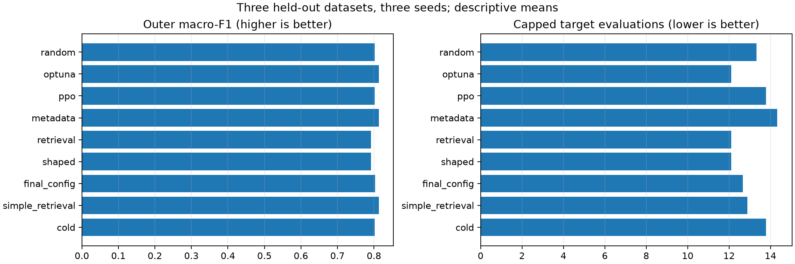
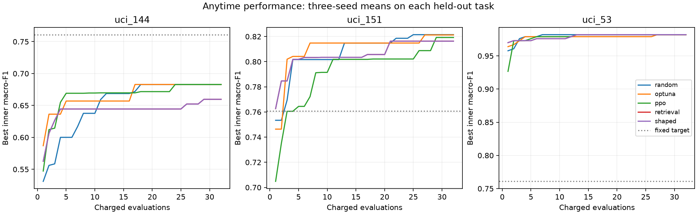

# TrajMeta-AutoML: controlled study report

This is a small CPU research study. It implements and evaluates trajectory transfer; it does not establish broad AutoML superiority.

## Design

Forty-eight classification pipelines, 32 charged evaluations per search, two fixed inner folds, and seeds 11, 29, 47. Repeated configurations and failures consume budget. All final methods use the same outer split. Outer labels are unavailable to search, retrieval, and tuning.

The training-only bank supervises one shared LSTM with within-task quality ranks. Terminal outcomes are masked from input. Metadata shortlists three source tasks, then cosine similarity selects high-ranked trajectories. Offline behavior cloning transfers their configurations without target evaluations. Shaped PPO adds a bounded potential difference, with zero terminal potential; retrieval-only uses the same warm start with zero shaping strength.

The encoder check holds out seed 47 within training tasks. It is not a dataset-disjoint generalization test. Metadata can encode dataset identity indirectly. Action aliases and prior best-score observations may affect representations. Validation tasks choose the gate/strength; final tasks are evaluated only after the source, bank, encoder, audit, and configuration are locked.

Selected gate: 0.8; shaping strength: 0.1; fixed target macro-F1: 0.760891.

## Results

- random: outer macro-F1 0.8019; inner anytime mean 0.8136; target reached 66.7%; capped target evaluations 13.33; unique configurations 23.3/32; mean search time 8.69s.
- optuna: outer macro-F1 0.8129; inner anytime mean 0.8182; target reached 66.7%; capped target evaluations 12.11; unique configurations 23.3/32; mean search time 10.28s.
- ppo: outer macro-F1 0.8019; inner anytime mean 0.8124; target reached 66.7%; capped target evaluations 13.78; unique configurations 25.3/32; mean search time 8.27s.
- metadata: outer macro-F1 0.8129; inner anytime mean 0.8126; target reached 66.7%; capped target evaluations 14.33; unique configurations 23.3/32; mean search time 9.87s.
- retrieval: outer macro-F1 0.7923; inner anytime mean 0.8093; target reached 66.7%; capped target evaluations 12.11; unique configurations 20.4/32; mean search time 305.03s.
- shaped: outer macro-F1 0.7923; inner anytime mean 0.8093; target reached 66.7%; capped target evaluations 12.11; unique configurations 20.4/32; mean search time 9.31s.
- final_config: outer macro-F1 0.8027; inner anytime mean 0.8168; target reached 66.7%; capped target evaluations 12.67; unique configurations 22.9/32; mean search time 10.37s.
- simple_retrieval: outer macro-F1 0.8129; inner anytime mean 0.8160; target reached 66.7%; capped target evaluations 12.89; unique configurations 24.7/32; mean search time 119.29s.
- cold: outer macro-F1 0.8019; inner anytime mean 0.8124; target reached 66.7%; capped target evaluations 13.78; unique configurations 25.3/32; mean search time 9.38s.

Shaped versus random changes the capped target-evaluation statistic by 9.2% (positive means fewer). Unreached targets are assigned budget + 1 for this descriptive statistic; this is not an uncensored time-to-target estimate or proof of the proposed 30% improvement.

There were 81 final runs, 2592 charged evaluations, 0 failed trials, and 26 warning-bearing trials. See statistics.json and test_results.json for all outcomes.

## Paired uncertainty

Seeds are averaged within each dataset before inference. Exact task-level sign flips and an enumerated empirical task bootstrap are reported. With only three final datasets, uncertainty is substantial and the minimum two-sided sign-flip p-value is 0.25. No comparison can establish conventional statistical significance. Multiple ablations are exploratory.

- Shaped minus random, outer macro-F1: -0.0097; descriptive interval [-0.0189, -0.0015]; exact p=0.500.
- Shaped minus ppo, outer macro-F1: -0.0097; descriptive interval [-0.0189, -0.0015]; exact p=0.500.
- Shaped minus retrieval, outer macro-F1: +0.0000; descriptive interval [+0.0000, +0.0000]; exact p=1.000.
- Shaped minus simple_retrieval, outer macro-F1: -0.0207; descriptive interval [-0.0360, -0.0048]; exact p=0.500.
- Shaped minus final_config, outer macro-F1: -0.0104; descriptive interval [-0.0171, -0.0028]; exact p=0.500.

## Encoder and validation diagnostics

Quality AUC: 0.6984; simple kNN AUC: 0.6595; mean within-task Spearman: 0.3431. Prefix diagnostics and collapse checks are retained in encoder_sanity.json.

Prefix AUC by step: {'1': 0.493859649122807, '2': 0.49678362573099416, '3': 0.58408057179987, '4': 0.6983755685510071}. The first two steps are near chance; passing the full-trajectory gate does not establish useful early-prefix guidance.

Validation inner anytime means: plain PPO 0.8144, Random 0.8083, Optuna 0.8201, retrieval 0.8233, shaped 0.8233. These are diagnostic development comparisons, not held-out results.

## Limits and conclusion

The final tasks are Iris, German Credit, and Sonar. Two validation tasks and this small test pool cannot support a generalization claim across domains. UCI source availability and dataset restrictions are documented in the audit; all initial source-access failures were resolved before training. No OpenML mirror-wide audit is claimed. Search times exclude bank generation and encoder training; offline transfer costs must be amortized in any deployment comparison. There is a per-trial timeout but no hard RAM cap.

The software and this bounded experiment are reproducible. Positive or negative point estimates do not by themselves validate trajectory transfer. A larger independently collected benchmark, more tasks, sensitivity studies, and an externally fixed score target are needed for a confirmatory research claim.

## Reproduction

Use the pinned environment, restore audited UCI data, run `python -m trajmeta.study --phase all`, then `python scripts/report_study.py`. Completed runs are resumed only when their signatures match; partial runs require inspection. Never alter the final protocol to fit test outcomes.

## Method references

- Schulman et al. (2017), [Proximal Policy Optimization Algorithms](https://arxiv.org/abs/1707.06347). PPO is provided by Stable-Baselines3; the trajectory transfer mechanism is implemented in this repository.
- Ng, Harada and Russell (1999), [Policy invariance under reward transformations](https://ai.stanford.edu/~ang/papers/shaping-icml99.pdf). This motivates potential differences; its conditions do not establish an empirical gain or a policy-invariance guarantee for this partial-observation implementation.

## Figures

## Research finding and timing limitations

The 30% improvement hypothesis is not supported. Shaped PPO changes the capped target-evaluation statistic by 9.2%, while outer macro-F1 falls from 0.8019 for Random Search to 0.7923. Shaped and retrieval-only aggregate outer macro-F1, anytime score and capped target counts are equal. Complete configuration/score sequences match in 6 of nine task/seed pairs. The added shaping term demonstrates no incremental measured benefit under this short-budget protocol. Cold fallback matches ordinary PPO exactly.

The timing audit found 3 trials whose elapsed time exceeded the configured 120-second worker response timeout. These observations remain in the raw results. Startup, send, scheduling and possible host suspension are not separately timed, so exact causes cannot be established. A strict end-to-end wall-time limit was not verified; wall-clock means must not be interpreted as algorithmic speed comparisons. See [timing audit](timing_audit.json).

Some German Credit final refits also emitted logistic convergence warnings. Search-trial warning counts exclude final refit warnings; predictions were evaluated as returned, without solver retuning on test outcomes.

Use `scripts/run_study.ps1` to verify saved evidence and regenerate this report. Use `python scripts/reproduce_study.py --scope full --output results/replication-001` for an independent isolated rerun after restoring audited data; see README.

## Execution amendment and verification

After 27 Iris runs, German Credit failed at manifest parsing before any evaluation. Its categorical-column list had been serialized as a Python representation instead of JSON. The metadata encoding and one audit-builder line were corrected; processed data, splits, hyperparameters, selection, encoder, bank, evaluator, retrieval, and statistical analysis were unchanged. The original protocol and all 138 previously completed run records were archived. Resume signatures were migrated transparently, and results were reused without rerunning or selecting outcomes. See [protocol amendment](protocol_amendment.json) and [original evidence](amendment-001/).

The completed package verifier checked 6144 evaluations, 5184 recorded episodes, all 16 dataset checksums, model/bank versions, exact budgets, split roles, reward telescoping, nine cold-start parity pairs, and preservation of the pre-amendment results. See [verification](verification.json).
